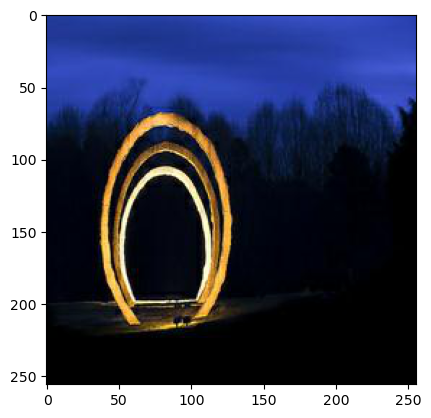
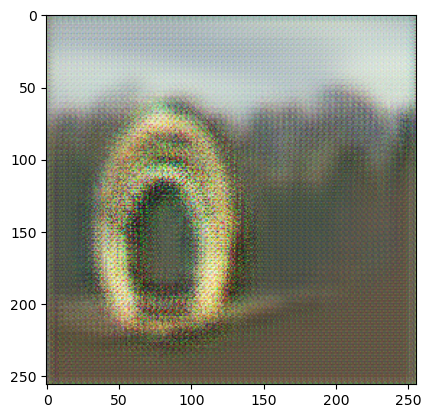
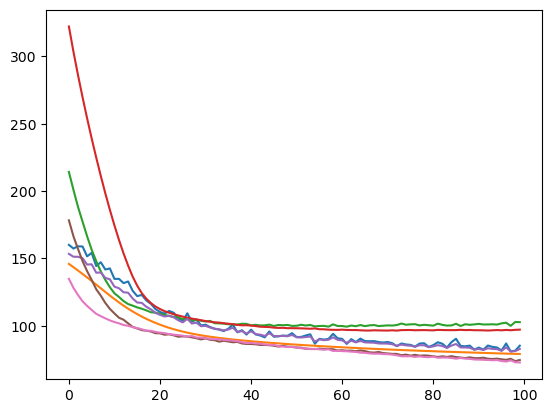

# CycleGAN: photos to Monet-style paintings

A course project for NI-MVI (Computational Intelligence Methods) at FIT CTU, winter semester 2022/23. It is a CycleGAN written from scratch in PyTorch for the Kaggle competition [I'm Something of a Painter Myself](https://www.kaggle.com/competitions/gan-getting-started). The competition asks for a model that turns photos into Monet-style paintings.

| Photo | Generated "Monet" after 100 epochs |
|---|---|
|  |  |

The output keeps the shapes from the photo, but it isn't convincing as a painting. The colours wash out, and there are checkerboard artefacts.

## Approach

- **Data:** 300 Monet paintings and about 7,000 photos, all 256×256 and unpaired. I used the JPG copies, dropped the duplicate TFRecords, and loaded them with torchvision's `ImageFolder`.
- **Why CycleGAN:** the two sets aren't paired, so a plain GAN isn't enough. A CycleGAN ([Zhu et al., 2017](https://arxiv.org/abs/1703.10593)) trains two generators (photo → Monet and Monet → photo) and two discriminators. A cycle-consistency loss requires that an image translated to the other domain and back matches the original.
- **Generators:** ResNet-style:
  - a 7×7 convolution
  - two stride-2 downsampling convolutions
  - 9 residual blocks
  - upsampling with sub-pixel convolution (`PixelShuffle`)
  - a `tanh` output

  They use instance normalisation and reflection padding.
- **Discriminators:** PatchGAN. Four stride-2 convolution blocks (64 → 512 channels) followed by a one-channel output map.
- **Losses:**
  - least-squares (MSE) adversarial loss
  - L1 cycle loss (weight 10)
  - L1 identity loss (weight 5)
- **Training:** Adam (learning rate 2e-4, betas 0.5 and 0.99), batch size 1, 100 epochs. One epoch took about 2 minutes on a CUDA GPU.

Most architecture choices and hyperparameters follow the CycleGAN paper and the public implementations cited in the report, mainly [pytorch-CycleGAN-and-pix2pix](https://github.com/junyanz/pytorch-CycleGAN-and-pix2pix) and Amy Jang's [Monet CycleGAN tutorial](https://www.kaggle.com/code/amyjang/monet-cyclegan-tutorial).



The chart shows the seven training losses over the 100 epochs: identity, adversarial and cycle losses for the generators, plus one loss per discriminator. The original plot has no legend.

## Known issues

- **Most photos are never used.** Each epoch zips the photo loader with the much smaller Monet loader, so it only sees about 300 of the ~7,000 photos.
- **The learning rate is far too small.** `custom_lr` returns an absolute learning rate, but `LambdaLR` multiplies the base rate by whatever the function returns. As committed, the effective rate is 2e-4 × 2e-4 = 4e-8. The function should return a factor instead: 1.0, then decreasing linearly to 0.
- **The notebook is rough.** It has leftover TODOs and commented-out code, and the saved outputs come from a short 10-epoch run, not the 100-epoch run in the report.

## Files

| File | Contents |
|---|---|
| `notebook.ipynb` | Data loading, models, training loop, loss plot, saving the models |
| `report.pdf` | The final two-page report |
| `checkpoint.pdf` | The milestone report (December 2022) |
| `report.zip` | LaTeX source of the report |
| `images/` | The figures from the report used in this README |

## Running it

Download the data from [Kaggle](https://www.kaggle.com/competitions/gan-getting-started/data), which needs an account. There is also a [Google Drive copy](https://drive.google.com/file/d/1-XE75v923yUErA51WDinQCtctNFTk-iW/view?usp=sharing) with both the original and the restructured data. The notebook expects this layout:

```
data-monet/
├── monet/monet/*.jpg
└── photo/photo/*.jpg
```

The extra nested folder is there because `ImageFolder` labels images by subfolder.

```bash
pip install torch torchvision matplotlib numpy jupyter
jupyter notebook notebook.ipynb
```

The notebook picks CUDA, Apple MPS or the CPU automatically. `EPOCH_COUNT` is set to 200, while the report's run used 100. Create `models/04/` before running the cell that saves the models.
